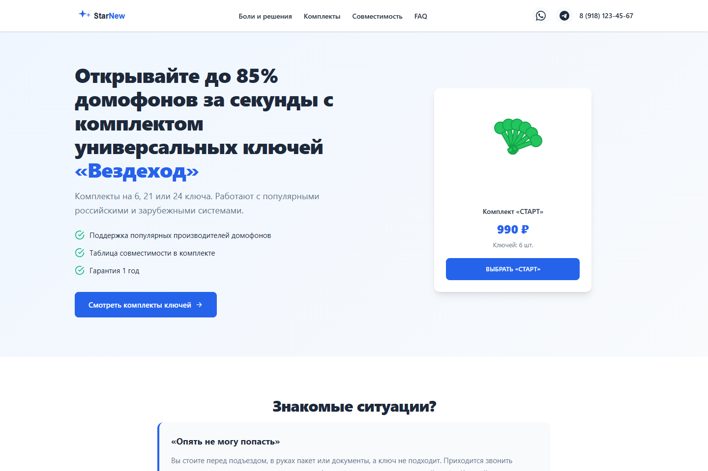
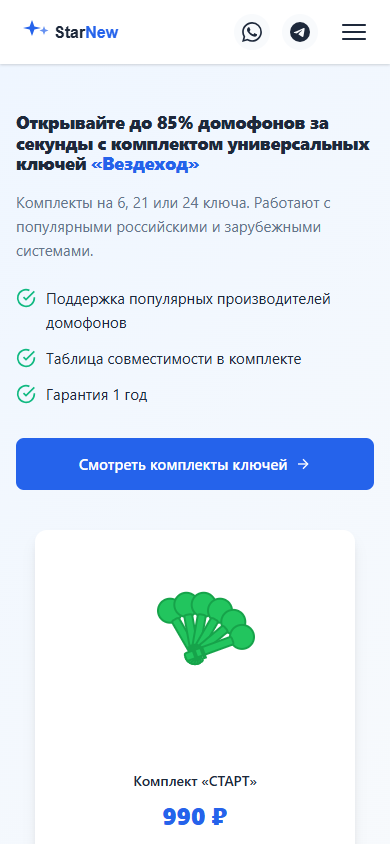

# StarNew — товарный лендинг

Адаптивная страница с комплектациями, сравнением, ответами на вопросы и формой заказа.

[Все проекты](https://github.com/gek-finn)

## Задача

Представить варианты товара и дать посетителю понятный путь к заявке.

## Что реализовано

- Первый экран и блоки преимуществ.
- Карточки комплектов и сравнение вариантов.
- FAQ, навигация и адаптация для телефона.
- Проверка полей формы.
- Шаблон интеграции заявок с Google Таблицами.

## Технологии

HTML · CSS · JavaScript · Google Apps Script

## Статус и ограничения

Демонстрационный лендинг. Формы в портфельной копии отключены от рабочей таблицы. Коммерческие цифры в макете не являются подтверждёнными результатами продаж.

## Интерфейс

Мобильный экран и другие разделы

## Запуск

Откройте `index.html` в браузере. Для просмотра на localhost: `python -m http.server 8080 --bind 127.0.0.1`.

## О кейсе

Описание показывает реализованные функции. Подтверждённые показатели продаж, экономии времени и коммерческого внедрения в этом кейсе не заявляются.
